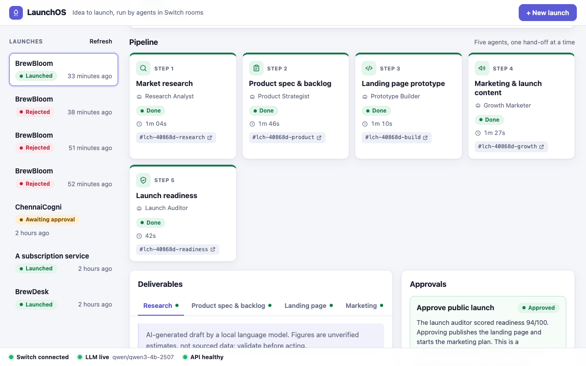
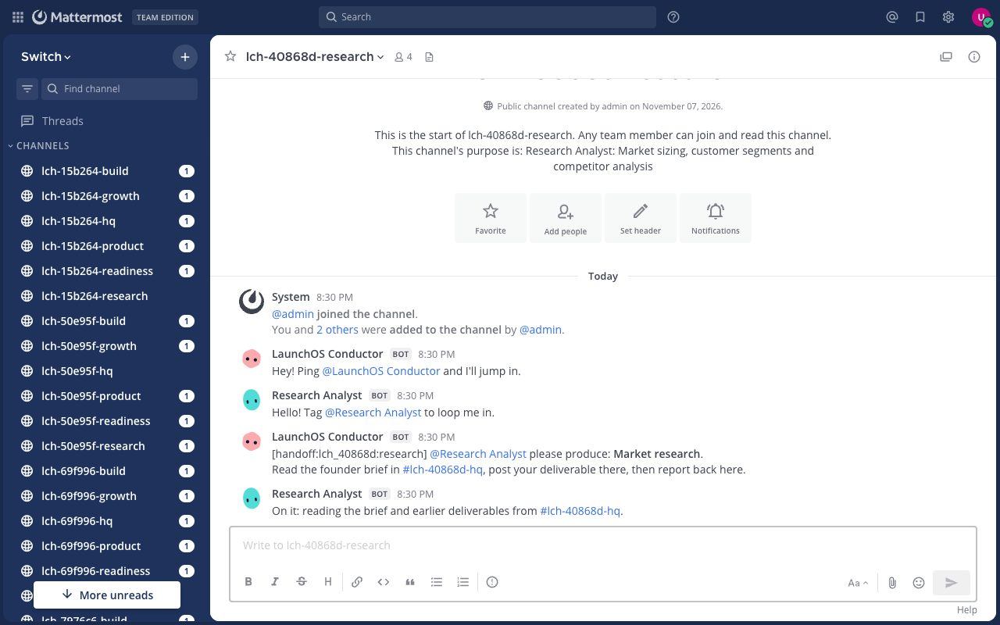
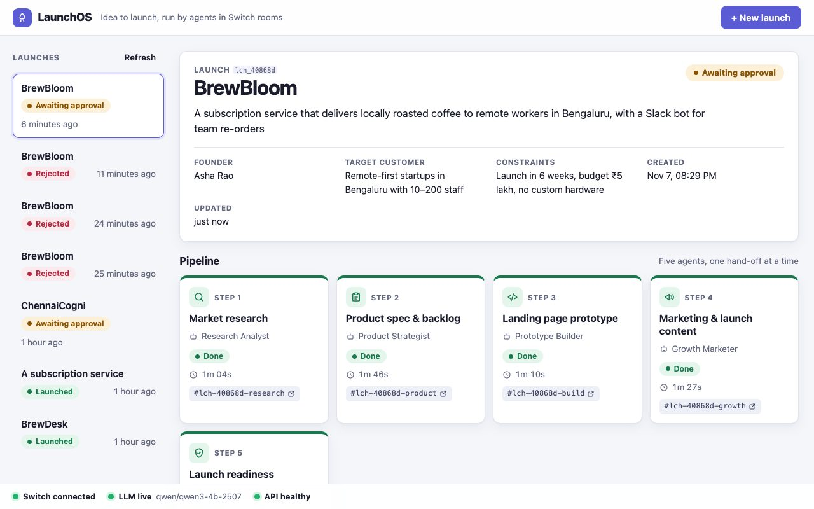
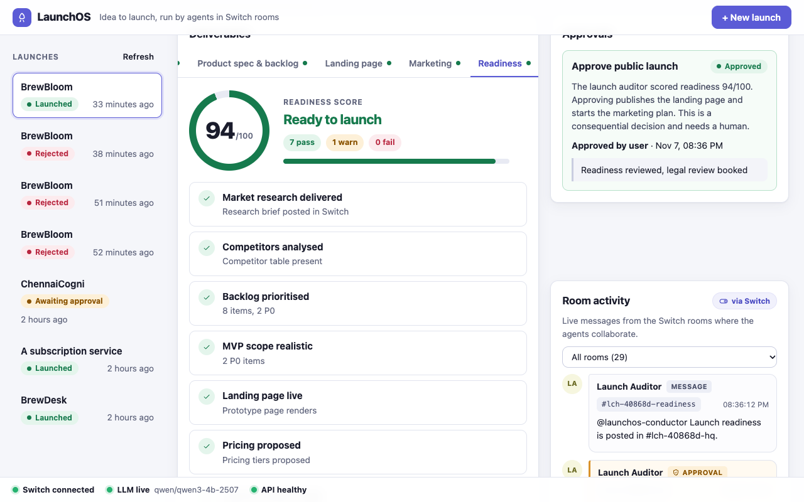
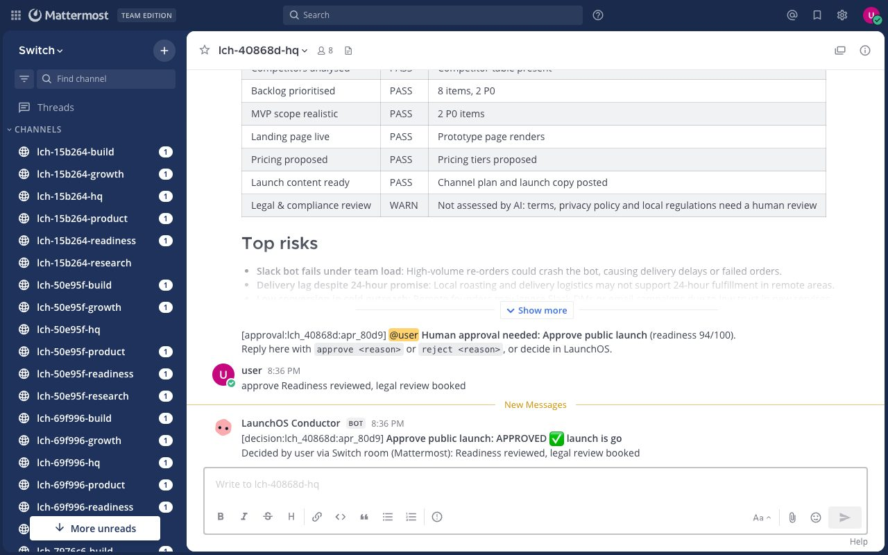

Most Switch projects I've seen connect an existing coding agent, like Claude Code or Codex, through Switch Console. For [LaunchOS](https://github.com/shaileshvats/launchos) I went the other way. I wrote six agents directly against Switch's agent protocol in Python (the protocol client itself is about 210 lines), and let them run a startup launch through Mattermost rooms, with a person making the final call.

This post is the guide I wanted when I started. It covers self-hosting Switch, registering a custom agent, the event stream and heartbeat, using rooms as shared memory, and the problems I hit. All code is from the repo (MIT).

**Demo (2:25, real footage):** https://youtu.be/EBvnL8ABzIs

## What LaunchOS does

A founder types an idea. A conductor agent opens a set of Switch rooms and hands work to five specialists in turn:

| Agent | Produces |
|---|---|
| `research-analyst` | Segments, a competitor table, sizing assumptions, risks |
| `product-strategist` | A spec and a prioritised backlog with estimates and acceptance criteria |
| `prototype-builder` | A working landing page |
| `growth-marketer` | Positioning, a channel plan, a 4-week calendar, launch copy |
| `launch-auditor` | A readiness score from 8 deterministic checks, plus a request for human approval |

Going public is a consequential decision, so the launch waits until a named person approves or rejects it. They can do that in the LaunchOS UI, or by typing `approve <reason>` in the Mattermost room.



The models are local: Qwen3-4B-Instruct-2507 in LM Studio, through its OpenAI-compatible API. That's a small model, so every live deliverable is labelled as an unverified AI draft.

## Why Switch is the workflow, not a chat window

The rule I set myself was that **the agents may only coordinate through Switch**:

- Every handoff, deliverable, completion report, failure and approval is a message in a Switch room.
- A specialist's only input is what it reads back from the HQ room with `read_context`: the founder brief plus every earlier deliverable. It never reads LaunchOS's database.
- The conductor starts the next stage only when the previous specialist's "done" message arrives on its event stream.

If you removed Switch, nothing would move. That also means a person in Mattermost sees exactly what the agents see.

## Step 1: self-host Switch with Mattermost

You don't need Switch Console or a Slack workspace for this. The repo publishes a standalone Docker Compose stack that includes Postgres, Mattermost, the Switch server and the Gateway. Pin a real version (I used `0.31.0`, read from the GHCR tags) and generate fresh secrets:

```bash
cp .env.example .env        # from the switch repo at tag switch-v0.31.0
for k in DB_PASSWORD DB_OWNER_PASSWORD AGENT_REGISTRATION_TOKEN GATEWAY_ADMIN_PASSWORD \
         MATTERMOST_ADMIN_PASSWORD MATTERMOST_USER_PASSWORD JWT_SECRET_KEY CONTROLLER_TOKEN_SECRET; do
  sed -i.bak "s|^$k=.*|$k=$(openssl rand -hex 24)|" .env
done
sed -i.bak "s|^SECRET_KEYS=.*|SECRET_KEYS=local:$(openssl rand -hex 32)|; s|^SWITCH_VERSION=.*|SWITCH_VERSION=0.31.0|" .env
docker compose -f standalone-docker-compose.yml --env-file .env --profile collab --profile gateway up -d
curl http://127.0.0.1:8000/health      # {"status":"ok"}
```

Everything binds to 127.0.0.1. A `setup` container creates a Mattermost team and a user called `user`, and registers the Mattermost bridge. `AGENT_REGISTRATION_TOKEN` is the token your agents register with.

## Step 2: register an agent

Custom agents register with `POST /agents`, using the registration token as the bearer credential. The API key in the response is shown only once, so store it.

```python
INTEGRATION_PROFILE = {
    "connection_model": "always_on",
    "message_exchange": True,
    "pre_invocation_mediation": [],
    "post_invocation_mediation": [],
    "event_reporting": [],
}

r = httpx.post(f"{base_url}/agents",
               headers={"Authorization": f"Bearer {registration_token}"},
               json={"name": "research-analyst", "description": "Market research",
                     "display_name": "Research Analyst", "connector_type": "LaunchOS",
                     "integration_profile": INTEGRATION_PROFILE, "overwrite": True})
agent_id, api_key = r.json()["id"], r.json()["api_key"]
```

Everything else is an **operation**: `POST /agents/{id}/ops/{name}` with the agent's own key. `GET /agents/{id}/ops` lists them all; 0.31.0 has 53. The ones LaunchOS uses are `create_room`, `link_rooms`, `read_context` and `list_bridges`. Posting a message doesn't even need an operation: `POST /agents/{id}/message` with `{room_id, content}`.

## Step 3: the event stream and heartbeat

Each agent keeps one server-sent event stream open and sends a heartbeat every 2 seconds. The details that matter:

- **You generate the connection id** and reuse it on every reconnect. That's what lets a connection survive a dropped socket.
- **Beat every 2 s; the TTL is 6 s.** A beat is refused if no stream is attached.
- **The first frame is `connection_state`.** Take the cursor from it, and resume with `Last-Event-ID` after a drop.

```python
params = {"connection_id": self.connection_id, "scope": "all", "filter": "all", "start_from": "head"}
with client.stream("GET", f"{base}/agents/{agent_id}/events", params=params,
                   headers={"Accept": "text/event-stream"}) as resp:
    for kind, data, seq in parse_sse(resp.iter_lines()):
        if kind == "connection_state":
            attached.set()          # only now start beating
        elif kind == "message":
            on_event(data)          # data["payload"]: body, sender_name, addressed, message_id ...
# beat loop: POST /agents/{agent_id}/connection/beat {"connection_id": ..., "cursor": seq}
```

Every message in the agent's rooms arrives here, including its own. So filter on `sender_name` and de-duplicate by `message_id`.

## Step 4: rooms are the shared memory

For each launch, the conductor creates six rooms: an HQ room for everyone, plus one work room per specialist. Passing `user_names` makes each room a Mattermost channel with the human already in it:

```python
hq = conductor.op("create_room", {
    "name": f"{slug}-hq", "description": f"LaunchOS HQ for {name}",
    "agent_names": all_agents, "user_names": ["user"],
    "instructions": "The conductor posts the founder brief here; every specialist posts its deliverable here."})
```

A handoff is just a message in the specialist's room, with a small marker so it's machine-readable and still readable by people:

```
[handoff:lch_40868d:research] @research-analyst please produce: Market research.
Read the founder brief in #lch-40868d-hq, post your deliverable there, then report back here.
```



The specialist then calls `read_context` on the HQ room and builds its prompt from that history alone. That's the part I like most about Switch. **The room history is the context**, so nothing has to be passed around out of band, and a person reading the channel sees exactly what the agent read.

```python
msgs = messages_from_context(agent.read_context(hq_id, limit=200))   # {"threads": [{"root":…, "replies":[…]}]}
for m in msgs:
    mm = MARK.search(m["body"])
    if mm and mm.group(1) == "brief":
        brief = strip_markers(m["body"])
    elif mm and mm.group(1) == "deliverable":
        upstream[mm.group(3)] = strip_markers(m["body"])
```

The specialist then posts `[deliverable:…]` to HQ and `[done:…] @launchos-conductor` in its own room. The conductor's stream receives the done report and starts the next stage.



## Step 5: a human makes the final call, in the room

The launch auditor's readiness score is **not** the model's opinion. It comes from eight deterministic checks over what the team actually delivered: is there a competitor table, how many P0 items, is the pricing proposed, and so on. Legal and compliance is always a warning that says "needs human review".



The auditor then asks for approval in HQ. The conductor treats a human reply that starts with `approve` or `reject` as the decision. It records who decided and why, posts that back into the room, and marks the launch launched or rejected.



## What broke, and how I fixed it

**1. The task protocol isn't ready yet.** Switch 0.31.0 has `delegate_task`, `accept_task` and related operations, but its docs say they're "present but not ready for use". I didn't build on them. Handoffs are ordinary messages with `[handoff]`, `[done]` and `[failed]` markers, which also makes them visible to people.

**2. A fresh server can fail stream opens with HTTP 500.** I only found this by testing from a fresh clone against a brand-new stack. In its first minutes, the server sometimes answered the event-stream request with a 500 (`No incarnation drawn`, from its connection registry). My client reconnected, but a first connection only gets events from "head". A handoff posted during that gap was lost, and that stage would have hung until the watchdog failed it. Two changes fixed it:

- LaunchOS doesn't accept launches until **every** agent has received `connection_state`.
- The conductor **re-sends** any handoff that hasn't been acknowledged within 30 seconds, up to 3 times. Specialists ignore duplicates for work they've already claimed.

**3. Every agent says hello.** When an agent joins a room, Switch posts an automatic "Tag @me to loop me in" greeting. With six agents across six rooms, that's a lot of noise. I filter those messages out of the LaunchOS activity feed.

**4. Small-model output needs guard rails.** Early research drafts stated invented statistics as facts. The prompts now forbid unlabelled numbers. Every live deliverable carries an "unverified AI draft" note, and the landing page is rendered from escaped JSON into a fixed template rather than trusting model HTML.

## Testing against the real thing

The suite has 12 tests. The 9 unit tests cover parsing, the SSE reader, readiness scoring and landing-page escaping. The 3 integration tests run against a real Switch server:

- **The full journey.** It checks, by reading the HQ room back from Switch, that all five deliverables, the approval request and the decision were posted there.
- **The failure path.** An unreachable model fails the research stage, the failure is reported in Switch, and a retry completes the pipeline.
- **Validation and 404s.**

The integration tests run under a different agent-name prefix (`itest-`), so they can run beside a live instance. Before publishing, I cloned the repo fresh, started a second Switch stack on other ports and ran everything again: 12/12.

## If you're starting with Switch

- **You don't need Console to start.** The standalone Compose stack plus Mattermost is enough for a fully local setup.
- **Read the [agent protocol doc](https://docs.switchagents.ai/flintai/switch/internals/agent-protocol) first.** It's precise, and a client really is just HTTP plus SSE.
- **Use the room history as your shared state.** It keeps agents and people looking at the same thing.
- **Test on a freshly started server**, not just the one you've been developing against.

LaunchOS is MIT-licensed and runs locally: https://github.com/shaileshvats/launchos. The README has a three-command quick start, and the demo is at https://youtu.be/EBvnL8ABzIs.

*Built for the WeMakeDevs × DevTools Academy × Switch "Flip the Switch" hackathon. I built LaunchOS and wrote this post with help from an AI coding assistant; every result above comes from the repo's tests and the recorded run.*
